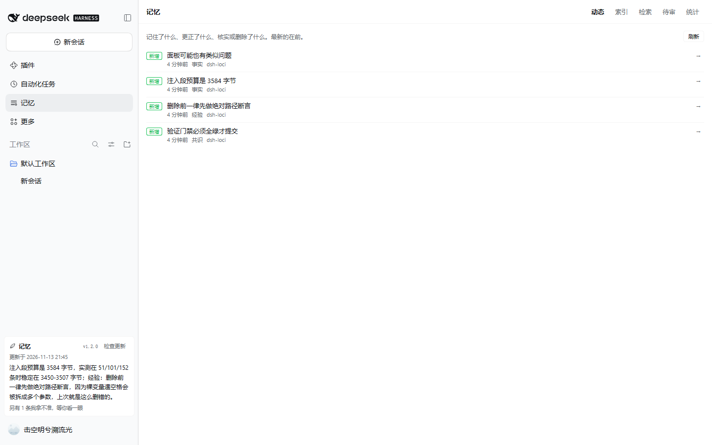

# dsh-loci · Loci

**A long-term memory for DeepSeek Harness where the prompt only ever sees the palace's index — every room is one lookup away.**

[中文](README.zh.md) · [Design](docs/DESIGN.md) · [Research](docs/RESEARCH.md) · [Operations](docs/OPERATIONS.md) · [Security](docs/SECURITY.md) · [Acceptance](docs/ACCEPTANCE.md)

```
system prompt:  ~1.3k tokens, stable, one line per fact
user asks     →  loci_search "发布顺序"   → total=3, one call
needs detail  →  loci_get m_01J…           → full text + history + evidence
```

## Why it exists

Every memory plugin tested in this workspace failed one of two ways: it cost a
fixed toll on every request (mnemon: +4.8 KB of system prompt, 16 tools), or it
grew without bound (ledger-memory: 7 KB → 27 KB per turn). The ones that stayed
cheap truncated recall silently (mnemon returned 4 of 20 requested rows;
auto-memory's index holds about 27 Chinese entries).

Loci is built around one rule: **the prompt holds an index, not a memory.**

- Empty store → **0 bytes injected**. No header, no advice, nothing.
- 100 entries → still one stable section, capped at a byte budget with an honest
  "… +N more" footer.
- A read-only turn → the section is byte-identical, so the prefix cache survives.
- A broad question → `loci_search` returns `total` and a cursor, so "list them
  all" is answerable.

## What it remembers



| Layer | Kind | Injected? | Example |
|---|---|---|---|
| rules | `rule` | yes, first | "删除前必须做路径断言" |
| semantic | `semantic` | yes, index line | "生产机是 prod-01" |
| procedural | `procedural` | yes, index line | "发布顺序 staging → canary → 全量" |
| episodic | `episodic` | yes, index line | "2026-11-13 会话摘要" |
| working | `working` | no | scratch facts for this session only |

Only `verified` entries are injected. Anything written without a verbatim quote
from the conversation is stored as a **candidate** and waits in the panel for
one click.

## Install

Inside the Harness profile that should have memory:

```text
Settings → Plugins → install from a directory or the market listing, or
dsh plugin --profile <name> add dsh-loci
```

The bundle adds one Host row (`dsh-loci`) and one Client half. Restart the
Harness, then open **Settings → Loci** or the **Memory** panel in the sidebar.

Requirements: DSH `>=0.2.2-rc.1 <0.3.0-0`, Node `>=24.9.0` (the Harness ships it).
No service and no native module.

The package also ships a small CLI (`snapshot`, `export`, `import`, `doctor`,
`stats`, `review`, `purge`, `migrate`, `rollback`). It is not on your `PATH` after a
plugin install — call it through the profile:

```text
node "$HOME/.dsh/profiles/<profile>/node_modules/dsh-loci/scripts/cli.mjs" doctor --json
```

Inside a chat there are zero-token slash commands too: `/loci`, `/loci review`,
`/loci doctor`, `/loci export`.

## The five tools

| Tool | Use |
|---|---|
| `loci_write` | Save, revise, or merge facts. `evidenceQuote` must be verbatim; without it the entry is a candidate. `op:'merge'` folds duplicate ids into one — the sources are superseded, never deleted. |
| `loci_search` | Hybrid search. Returns `total`, `hasMore`, `cursor`; `detail` is snippet/overview/full. Omit `query` to list the newest entries. |
| `loci_get` | Full text plus revision history and the evidence quote. |
| `loci_forget` | Soft-delete (history kept) or restore. |
| `loci_stats` | Counts, budget use, channel health, database location. |

Tool names are prefixed `loci_` on purpose: `ctx.tools.register` throws on a
duplicate name, so two memory plugins both claiming `memory_search` would break
one of them.

## Where you see it

- **Sidebar note** — a small card beside Settings, like the quota and advisor
  cards: a shadowed card in the sidebar footer with a status dot, a `updated <time>` stamp and numeric rows (verified / pending / disputed, index bytes against the budget, injected / opened / dead weight)
  over one short paragraph of what the agent currently understands in this
  project (a consensus, a lesson, a fact), plus one quiet line if something is
  waiting for your review. It answers "did it take that in?" — no counters.
  The version sits in small text with an explicit "check for updates", the only
  path that touches the network.
- **Memory panel** — the full view, opening on a **Feed** of every add, revision,
  verification, pin, deletion and import, newest first.
- **Settings → Loci** — the budget, capture mode, default scope, secret policy
  and embedding channel.

## Configuration

Everything lives in the plugin's Loader row; Loci never reads a project file.
The settings page writes the fields marked *live* without a restart.

| Key | Default | Meaning |
|---|---|---|
| `sectionMaxBytes` | `3584` | hard byte budget for the injected section (max 16384) |
| `rulesMaxBytes` | `1024` | ceiling for the rules block inside that budget |
| `defaultScope` | `workspace` | scope a write lands in when it does not say |
| `captureMode` | `rules` | deterministic capture of explicit durable statements |
| `extractMode` | `off` | `session` asks the model once, when a session ends, for up to `extractSessionMaxCandidates` proposals — one sitting to review, not one per turn. `turn`/`on` keep the older per-turn behaviour. Always candidates, always budgeted |
| `recallAssist` | `off` | one bounded first-turn recall block per session |
| `maintenanceMode` | `sweep` | TTL, index repair, and embedding backfill every 6h |
| `secretPolicy` | `redact` | redact high-confidence secrets, or refuse the write |
| `vectorMode` | `off` | optional HTTP embedding channel; lexical always works |
| `allowHardDelete` | `false` | enable `purge` in the CLI/panel |

## What it will not do

- Capture and the session summary are deterministic — no model call, so their cost is
  visible and zero. The only model call is `extractMode`, which is **off** by default
  and only runs when you set it.
- No cloud, no telemetry. Three optional network paths, all off by default: the update
  check (`updateCheck`), the HTTP embedding channel (`vectorMode: 'http'`), and session
  extraction (which sends the recent conversation to your configured model through the
  Harness).
- Session reads use an explicit scope-key set, never a wildcard. The panel and export
  enumerate every scope — an admin view, not a session read.
- No physical deletion by default; `purge` needs a config switch, a confirmation,
  and leaves an audit line.

## Data

`$DSH_HOME/memory/loci/` only:

```
memory.db            SQLite (WAL) — the transactional truth
audit.jsonl          append-only: inject / recall / write / verify / delete
backups/             pre-migration and manual snapshots (VACUUM INTO)
markdown/            human-readable projection
exports/             export bundles and import drops
```

Uninstalling the plugin leaves the directory untouched, by design. Delete it
yourself when you mean it.

## License

MIT. See [NOTICE](NOTICE) for the research lineage of each mechanism.
